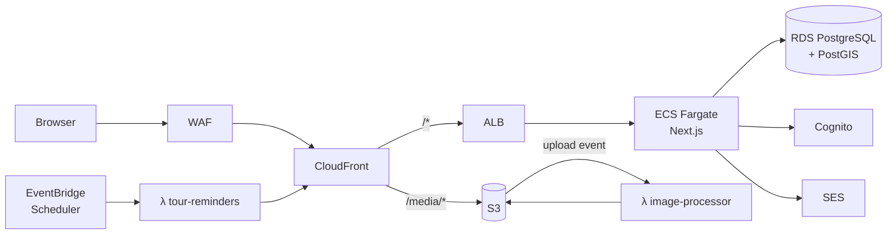

# GharKhoj — rentals across Nepal

> Find rooms, flats, apartments, houses and office space for rent in Kathmandu, Lalitpur, Pokhara and beyond, with real photos, map search and visits booked online.

   

## Highlights

- **Nepal-first:** water supply and power backup as first-class fields, tenant preferences (family/students/bachelors), ward + tole + landmark addresses, NPR with lakh grouping, ropani-aana area display, Nepal time (UTC+05:45), Nepali mobile validation.
- **Search like apartments.com:** 12 filter types, URL-shareable state, list ↔ map view with clustered price pins, "search this area", radius and "near me" search, SEO pages per city, neighbourhood and property type.
- **Landlord tools:** guided listing form, draggable map pin with privacy-preserving "approximate location", direct-to-S3 photo uploads (EXIF GPS stripped, WebP variants), floor plans, moderation workflow, tour availability, dashboard.
- **Tours:** pick up to 3 times, idempotent requests, confirm / reschedule / decline, emails to both parties, 24 h and 2 h reminders, add-to-calendar.
- **Trust & safety:** moderation queue with scam-signal flags and duplicate detection, reports and takedowns, landlord document verification, Rekognition image moderation, audit log.
- **Production-grade:** Cognito auth, WAF, private RDS, least-privilege IAM (tested), CI/CD with OIDC, alarms, budget, 136 automated tests.

## Architecture



Details: [docs/02-design/architecture.md](docs/02-design/architecture.md).

## Tech stack

| Layer    | Technologies                                                                                                                                                                                                                                         |
| -------- | ---------------------------------------------------------------------------------------------------------------------------------------------------------------------------------------------------------------------------------------------------- |
| Frontend | Next.js 15 (App Router, SSR), React 19, TypeScript (strict), Tailwind CSS 4, shadcn/ui (Radix), React Hook Form + Zod, TanStack Query, nuqs, Leaflet + OpenStreetMap + markercluster, Embla, yet-another-react-lightbox, react-day-picker, next-intl |
| Backend  | Next.js Route Handlers, service/repository layers, Prisma 6, PostgreSQL 16 + PostGIS + pg_trgm, Zod, Pino, sharp, jose, aws-jwt-verify                                                                                                               |
| AWS      | CloudFront, WAF, ALB, ECS Fargate (ARM64), RDS, S3, Lambda, EventBridge Scheduler, Cognito, SES, SNS, Rekognition, Secrets Manager, CloudWatch, Budgets, ECR, CDK (TypeScript)                                                                       |
| Quality  | Vitest, Testing Library, Playwright, axe-core, ESLint, Prettier, Husky + lint-staged, GitHub Actions, Dependabot                                                                                                                                     |
| Local    | Docker Compose: PostGIS, MinIO (Chainguard), Mailpit                                                                                                                                                                                                 |

## Quick start

```bash
cp .env.example .env.local    # fill SESSION_SECRET and INTERNAL_API_SECRET
ln -s .env.local .env
pnpm setup                    # install, start docker services, migrate, create bucket, seed demo data
pnpm dev                      # http://localhost:3000 → /login → pick a demo account
```

Full guide: [docs/03-development/local-setup.md](docs/03-development/local-setup.md).

| Command                                    |                                                                 |
| ------------------------------------------ | --------------------------------------------------------------- |
| `pnpm lint && pnpm typecheck && pnpm test` | Fast gate (65 unit tests)                                       |
| `pnpm test:integration`                    | 46 tests against PostGIS + MinIO                                |
| `pnpm test:e2e`                            | 12 Playwright tests incl. the full MVP flow and accessibility   |
| `pnpm --dir infra test`                    | 13 infrastructure security assertions                           |
| `pnpm --dir infra cdk deploy --all`        | Deploy to AWS ([guide](docs/05-operations/deployment-guide.md)) |

## Documentation

Everything lives in [`docs/`](docs/README.md):

| For                                                   | Read                                                                                                                                                                                                                                                   |
| ----------------------------------------------------- | ------------------------------------------------------------------------------------------------------------------------------------------------------------------------------------------------------------------------------------------------------ |
| **Users** (renters, landlords, admins)                | [User guide](docs/user-guide/README.md)                                                                                                                                                                                                                |
| **Stakeholders**: what was built, which tech, and why | [Technical overview](docs/stakeholder/technical-overview.md)                                                                                                                                                                                           |
| Product & requirements                                | [PRD](docs/01-requirements/PRD.md) · [SRS](docs/01-requirements/SRS.md)                                                                                                                                                                                |
| Engineers                                             | [Architecture](docs/02-design/architecture.md) · [Data model](docs/02-design/data-model.md) · [API](docs/02-design/api-reference.md) · [Security](docs/02-design/security.md) · [ADRs](docs/02-design/adr/README.md) · [Contributing](CONTRIBUTING.md) |
| QA                                                    | [Test plan & report](docs/04-testing/test-plan.md) · [Performance](docs/04-testing/performance.md) · [Accessibility](docs/04-testing/accessibility.md)                                                                                                 |
| Ops                                                   | [Deployment](docs/05-operations/deployment-guide.md) · [Runbook](docs/05-operations/runbook.md) · [Costs](docs/05-operations/cost-estimate.md) · [Release checklist](docs/05-operations/release-checklist.md)                                          |

## Repository layout

```
src/app          pages + /api/v1 route handlers        src/server   services, repositories, auth, media, emails
src/components   UI                                     src/schemas  shared Zod schemas
prisma/          schema, migrations, seed               lambdas/     image-processor, tour-reminders
infra/           AWS CDK stacks + tests                 tests/       unit, integration, e2e
docs/            SDLC documentation                     .github/     CI/CD, templates
```

## License

Proprietary. © 2026 GharKhoj. All rights reserved.
