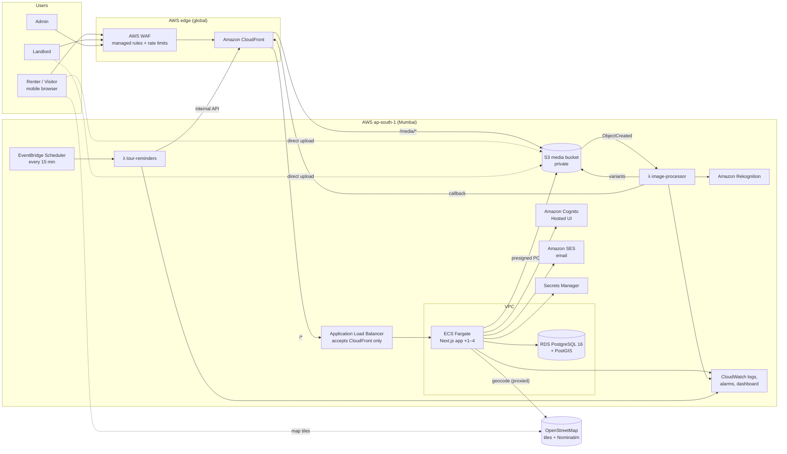
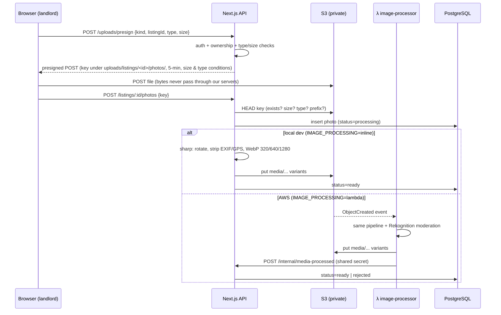
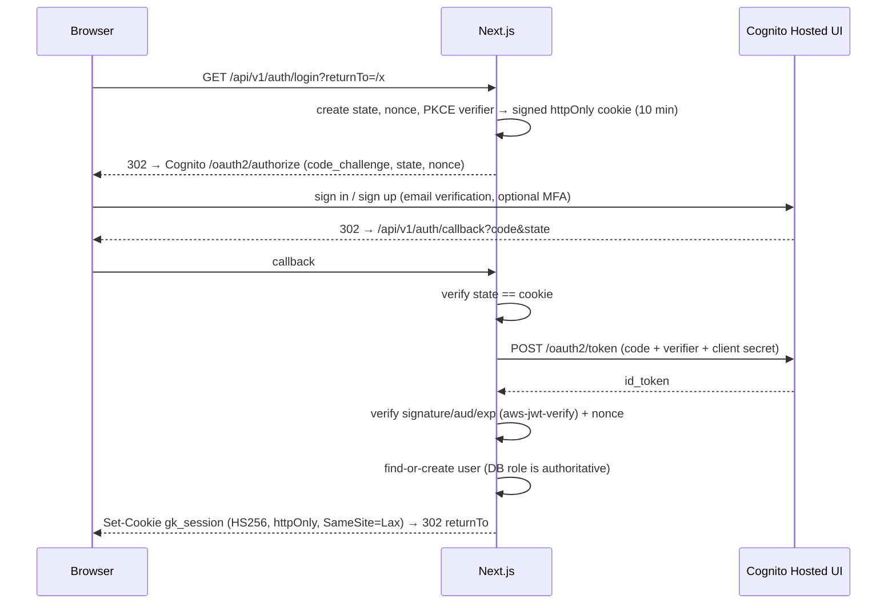

# System Architecture — GharKhoj

> Audience: engineers and technical reviewers. A plain-language version is in the [stakeholder technical overview](../stakeholder/technical-overview.md).

## 1. Architecture at a glance

GharKhoj is a **modular monolith**: one Next.js application serves the web pages _and_ the REST API, with business logic isolated in `src/server/services/` so it can be extracted into separate services later without rewriting it. Long-running or event-driven work (image processing, scheduled reminders) runs in AWS Lambda.



## 2. Request flows

### 2.1 Page view / search

1. Browser → CloudFront (WAF evaluates rules) → ALB (checks the secret `X-Origin-Verify` header) → Next.js on Fargate.
2. Next.js renders the page on the server (SSR), calling services directly — no internal HTTP hop.
3. The search service runs one parameterised SQL query (filters + PostGIS + full-text) and returns cards.
4. The signed-in part of the header hydrates client-side from `/api/v1/me`, so page HTML is the same for everyone and can be cached at the CDN.

### 2.2 Photo upload (direct to S3)



### 2.3 Sign-in (Cognito, Authorization Code + PKCE)



### 2.4 Tour lifecycle

`requested → confirmed | declined | rescheduled → completed | cancelled | no_show`. The rules live in `tour-rules.ts` (pure, unit-tested). Emails are sent on each transition, and EventBridge Scheduler runs the reminder job every 15 minutes, which claims each reminder atomically so it is sent once.

## 3. Code organisation

```
src/
├─ app/                     Next.js App Router
│  ├─ (public)/             home, /rent/*, /listing/[slug], /login, legal pages
│  ├─ (renter)/account/     profile, favourites, tours, saved searches
│  ├─ (landlord)/landlord/  dashboard, listings (new/edit/tours), tour inbox, verification
│  ├─ (admin)/admin/        moderation, reports, verifications, users, lookups, audit
│  └─ api/v1/…              REST route handlers (thin: parse → service → respond)
├─ components/              UI (shadcn/ui primitives in components/ui)
├─ server/
│  ├─ services/             business logic (the "domain")
│  ├─ repositories/         SQL / Prisma access, incl. raw PostGIS
│  ├─ auth/                 sessions, Cognito, guards, internal-secret auth
│  ├─ media/                image pipeline + moderation (shared with Lambda)
│  ├─ emails/               transactional email templates
│  └─ lib/                  env, db, logger, errors, http, storage, mailer, sms, rate limit
├─ schemas/                 Zod schemas shared by forms and API
├─ lib/                     client-safe utilities (formatting, constants, time, API client)
└─ middleware.ts            page guards, CSRF, request ids
lambdas/                    image-processor, tour-reminders
infra/                      AWS CDK (5 stacks) + infrastructure tests
prisma/                     schema, migrations (incl. reference data), seed
tests/                      unit, integration (real PostGIS/MinIO), e2e (Playwright)
```

**Layering rule:** route handler → service → repository/Prisma. Services receive the acting user as a parameter (`SessionUser | null`) and never read HTTP state, which keeps them testable and reusable from Lambdas or jobs.

## 4. Data architecture

- **PostgreSQL 16 + PostGIS** is the system of record. `listings.location` is `geography(Point,4326)` with a GiST index. `search_vector` is a generated `tsvector` with a GIN index. A partial index covers `status='published'`.
- **S3 key spaces:** `uploads/` holds private originals (expire after 180 days); `media/` holds public variants served through CloudFront; `private/` holds verification documents, reachable only through short-lived signed URLs.
- **Caching:** lookup data via `unstable_cache` (1 h, tag `lookups`); public search API responses `s-maxage=60` at CloudFront; static assets immutable.
- Details: [data model](data-model.md).

## 5. Deployment architecture (AWS CDK)

| Stack                      | Contents                                                                                                       |
| -------------------------- | -------------------------------------------------------------------------------------------------------------- |
| `gharkhoj-ci`              | ECR repository, GitHub OIDC provider + deploy role                                                             |
| `gharkhoj-waf` (us-east-1) | WAF Web ACL for CloudFront                                                                                     |
| `gharkhoj-network`         | VPC: 2 AZs, public / private-with-egress / isolated subnets, 1 NAT, S3 gateway endpoint, flow logs             |
| `gharkhoj-data`            | RDS PostgreSQL 16, isolated subnets, encrypted, TLS forced, 7-day backups                                      |
| `gharkhoj-app`             | CloudFront, ALB, ECS Fargate (ARM64), S3, Cognito, SES, Secrets, Lambdas, Scheduler, alarms, dashboard, budget |

CI/CD: GitHub Actions → OIDC role → build arm64 image → push to ECR → `cdk deploy -c imageTag=<sha>` → smoke test `/api/health` reports the new version. ECS deployment circuit breaker rolls back automatically if new tasks fail health checks.

## 6. Scalability path

| Pressure          | Next step                                                                                                       |
| ----------------- | --------------------------------------------------------------------------------------------------------------- |
| Web CPU           | ECS autoscaling already 1→4 tasks; raise max / task size                                                        |
| DB reads          | Add RDS read replica; point search queries at it                                                                |
| Search complexity | Move search to Amazon OpenSearch (schema-compatible card projection already isolated in `search-repository.ts`) |
| Image volume      | Lambda scales automatically; add SQS buffer between S3 and Lambda                                               |
| Global users      | Already behind CloudFront; add custom domain + HTTPS to origin                                                  |

## 7. Key decisions

See the [Architecture Decision Records](adr/README.md).
