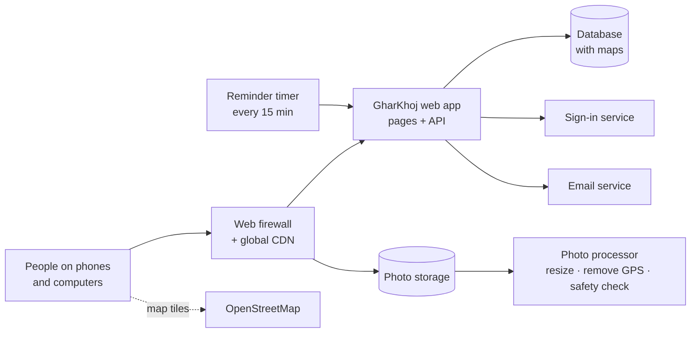
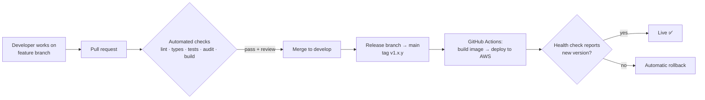

# GharKhoj — Technical Overview for Stakeholders

_Prepared by the engineering team · 16 November 2026 · Version 1.0_

This document explains **what was built, which technologies were used, why each was chosen, and how they work together**. It is written for owners, investors, partners and new team members, so technical terms are explained along the way and collected in a [glossary](#12-glossary) at the end.

---

## 1. Executive summary

**GharKhoj** is a rental marketplace for Nepal, comparable to apartments.com but designed for local realities: water supply and power backup as first-class information, tenant preferences (family / students / bachelors), ward-and-tole addresses with map pins, prices in Nepali Rupees with lakh formatting, and a mobile-first design for Nepali 3G/4G networks.

**Status: v1.0 is feature-complete for the MVP and tested end to end.** The AWS infrastructure is fully written as code and validated; going live is a single deploy command once the account owner approves the monthly cost.

| What                   | Result                                                                                                                                                           |
| ---------------------- | ---------------------------------------------------------------------------------------------------------------------------------------------------------------- |
| Features delivered     | Listings with photos and map, search (list + map), accounts and roles, favourites, tour scheduling with email and reminders, admin moderation and trust & safety |
| Launch cities          | Kathmandu, Lalitpur, Bhaktapur, Pokhara, Biratnagar, Bharatpur, Birgunj, Butwal, Dharan, Hetauda (~40 neighbourhoods)                                            |
| Automated tests        | **136 automated tests** (65 unit, 46 integration, 13 infrastructure, 12 browser end-to-end), all passing                                                         |
| Speed                  | Pages become visible in **~0.3 s on 4G and ~0.8 s on 3G** in a mid-range-phone simulation (target: under 2.5 s)                                                  |
| Accessibility          | 0 serious accessibility violations on key pages (WCAG 2.1 AA checks)                                                                                             |
| Security               | Modern sign-in (Amazon Cognito), web firewall, encrypted data, private database, least-privilege permissions, audit trail                                        |
| Estimated running cost | **≈ US $125–130/month** at launch scale, with a budget alarm at $150                                                                                             |

---

## 2. What the product does

| Who           | What they can do                                                                                                                                                                                                                                                                             |
| ------------- | -------------------------------------------------------------------------------------------------------------------------------------------------------------------------------------------------------------------------------------------------------------------------------------------- |
| **Visitors**  | Search by city/neighbourhood/keyword; filter by price, rooms, furnishing, amenities, tenant type, pets, parking, move-in date; switch to a map with price bubbles; view full listing pages                                                                                                   |
| **Renters**   | Everything above, plus save favourites and searches, request visits at up to 3 preferred times, get confirmation and reminder emails, add visits to their calendar, report suspicious listings, delete their account                                                                         |
| **Landlords** | Create listings with photos, floor plans and a map pin (optionally showing only an approximate location); submit for review; pause, mark as rented, duplicate; set visiting hours; confirm, decline or reschedule visits; see views and saves; get a "Verified" badge by uploading documents |
| **Admins**    | Approve or reject new listings (with automatic scam warning flags), handle reports and take down listings, verify landlords, manage users and reference data, view metrics and a permanent audit log                                                                                         |

**The core journey, tested automatically on every change:**
landlord lists a home → admin approves → renter finds it on the list and map → renter saves it and requests a visit → landlord confirms → both get an email.

---

## 3. The big picture: how it fits together

**In plain words:**

1. A person opens GharKhoj. Their request first passes a **web firewall** that blocks attacks and abuse, then a **content delivery network (CDN)** that serves pages and photos from a location close to them.
2. The **web app** builds the page, looking things up in the **database**, which also understands geography ("listings within 2 km of here").
3. When a landlord uploads photos, they go **straight to secure storage**, which saves bandwidth and server cost. A small **photo processor** then shrinks them for phones, removes hidden GPS data, and checks them for inappropriate content.
4. **Sign-in** is handled by a specialised Amazon service, so GharKhoj never stores passwords.
5. **Emails** (visit requests, confirmations, approvals) go through Amazon's email service. A **timer** sends visit reminders.

---

## 4. Technology choices, explained

Every choice below is backed by an Architecture Decision Record in `docs/02-design/adr/`.

### 4.1 The application (what users interact with)

| Technology                           | What it is                                                                              | Why we use it                                                                                                                                                                       | Where                                |
| ------------------------------------ | --------------------------------------------------------------------------------------- | ----------------------------------------------------------------------------------------------------------------------------------------------------------------------------------- | ------------------------------------ |
| **Next.js 15** (React 19)            | The most widely used framework for building React websites; renders pages on the server | Search engines can read listing pages (good for Google ranking); pages appear fast on slow phones; one codebase for both website and API                                            | Whole app (`src/app`)                |
| **TypeScript** (strict)              | JavaScript with type checking                                                           | Catches whole classes of bugs before release; makes the code safer to change                                                                                                        | All code                             |
| **Tailwind CSS + shadcn/ui** (Radix) | Styling system + accessible ready-made components                                       | Consistent, responsive design; built-in keyboard and screen-reader support                                                                                                          | All screens                          |
| **React Hook Form + Zod**            | Form handling + validation rules                                                        | The **same rules** check data in the browser (instant feedback) and on the server (security). For example, a rent of "18000.50" is rejected because money is stored in whole rupees | Listing form, all API inputs         |
| **TanStack Query**                   | Data fetching & caching in the browser                                                  | Fast, smooth interactions (e.g. the heart icon updates instantly)                                                                                                                   | Favourites, map, session             |
| **nuqs**                             | Keeps filters in the page address                                                       | Searches can be shared and bookmarked, and are visible to Google                                                                                                                    | Search filters                       |
| **Leaflet + OpenStreetMap**          | Open-source map library + free map data                                                 | OpenStreetMap often covers Nepal better than commercial maps; no licence fees                                                                                                       | Map search, pin picker, listing maps |
| **Nominatim** (via our server)       | OpenStreetMap's address search                                                          | Lets landlords find their landmark; our server caches results and respects usage limits                                                                                             | "Find" in the pin picker             |
| **Embla Carousel + Lightbox**        | Swipeable photo gallery with zoom                                                       | Smooth phone experience                                                                                                                                                             | Listing page                         |
| **react-day-picker**                 | Calendar component                                                                      | Renters pick visit days                                                                                                                                                             | Tour booking                         |
| **next-intl**                        | Translation framework                                                                   | English now; **Nepali can be added** without rewriting screens                                                                                                                      | All text                             |

### 4.2 The server side (business logic and data)

| Technology                      | What it is                                | Why we use it                                                                                                    |
| ------------------------------- | ----------------------------------------- | ---------------------------------------------------------------------------------------------------------------- |
| **Node.js 22**                  | The runtime that executes our server code | Same language as the front end, so one team can work across the whole system                                     |
| **PostgreSQL 16**               | A proven, open-source relational database | Reliable, transactional, free; runs on AWS RDS                                                                   |
| **PostGIS**                     | Geography extension for PostgreSQL        | "Search this map area", "within 2 km", "nearest first", duplicate detection by distance, all inside the database |
| **PostgreSQL full-text search** | Built-in keyword search                   | Keyword search without paying for a separate search service; OpenSearch is the documented upgrade path           |
| **Prisma**                      | Database toolkit                          | Type-safe queries, versioned database migrations (every schema change is reviewed and recorded)                  |
| **sharp**                       | Image processing library                  | Converts photos to the modern WebP format at 3 sizes, so a phone only downloads what it needs; removes GPS data  |
| **Pino**                        | Structured logging                        | Every request has an ID that support can trace through the logs                                                  |

**How the code is organised.** Business rules (who can do what, listing statuses, visit scheduling) live in one clearly separated layer, `src/server/services`. Screens and APIs are thin layers on top. This makes the rules easy to test and lets parts move into separate services later without a rewrite.

### 4.3 Amazon Web Services (where it runs)

We chose **AWS in the Mumbai region (ap-south-1)**, the closest AWS data centre to Nepal. Everything is defined as code with the **AWS CDK**, so the whole environment can be recreated, reviewed and audited like any other code.

| AWS service                    | Role in GharKhoj                                        | Why                                                                                                                            |
| ------------------------------ | ------------------------------------------------------- | ------------------------------------------------------------------------------------------------------------------------------ |
| **CloudFront**                 | Global CDN in front of everything                       | Fast delivery from edge locations near Nepal; free HTTPS                                                                       |
| **AWS WAF**                    | Web application firewall                                | Blocks common attacks, known-bad IPs, and floods of requests (rate limits)                                                     |
| **Application Load Balancer**  | Distributes traffic to app servers                      | Health checks and zero-downtime deploys; it only accepts traffic coming through CloudFront                                     |
| **ECS Fargate** (ARM/Graviton) | Runs the web app in containers without managing servers | Scales from 1 to 4 copies automatically; ARM processors are ~20% cheaper; **automatic rollback** if a new version is unhealthy |
| **RDS for PostgreSQL**         | Managed database                                        | Automatic backups (7 days, point-in-time restore), encryption, patching; kept in a private network with no internet access     |
| **S3**                         | File storage for photos and documents                   | Cheap, durable. Original uploads and identity documents stay private; only processed photos are published                      |
| **Lambda**                     | Small serverless functions                              | Photo processing (on upload) and visit reminders (every 15 min); pay only when they run                                        |
| **EventBridge Scheduler**      | Cloud timer                                             | Triggers visit reminders reliably                                                                                              |
| **Rekognition**                | AI image moderation                                     | Flags inappropriate photos before they are published                                                                           |
| **Cognito**                    | User sign-up/sign-in                                    | Email verification, password reset and optional 2-step verification; **we never store passwords**                              |
| **SES** / **SNS**              | Email / SMS                                             | Transactional emails; SMS is ready but switched off until delivery to Nepali carriers is tested                                |
| **Secrets Manager**            | Secure storage for passwords and keys                   | No secrets in code or settings files                                                                                           |
| **CloudWatch**                 | Monitoring, logs, alarms, dashboard                     | Email alerts if errors rise, pages slow down, servers fail, or background jobs fail                                            |
| **AWS Budgets**                | Cost alarm                                              | Emails when spending approaches the monthly budget                                                                             |
| **ECR**                        | Private container registry                              | Stores each released version of the app                                                                                        |

### 4.4 Engineering process & quality

| Practice / tool               | Purpose                                                                                                                                                                                                                               |
| ----------------------------- | ------------------------------------------------------------------------------------------------------------------------------------------------------------------------------------------------------------------------------------- |
| **Git + Git Flow**            | Every feature was built on its own branch (`feature/phase-1-listings-crud` … `feature/phase-9-polish`) and merged into `develop`; releases go to `main` and are tagged (`v1.0.0`). The full history shows what changed, when and why. |
| **Conventional Commits**      | Readable change history (`feat:`, `fix:`, `docs:`), enforced automatically                                                                                                                                                            |
| **ESLint, Prettier, Husky**   | Automatic code-quality and formatting checks before every commit                                                                                                                                                                      |
| **Vitest**                    | Fast automated tests for business rules and data access (against a real database)                                                                                                                                                     |
| **Playwright + axe-core**     | Robot browsers that click through the real app like users, on desktop and phone sizes, including accessibility checks                                                                                                                 |
| **GitHub Actions**            | On every change: lint → type check → tests → security audit → build. On merge to `main`: build, deploy to AWS, then verify the new version is live                                                                                    |
| **OIDC deploy role**          | GitHub deploys to AWS **without stored passwords or keys**                                                                                                                                                                            |
| **Dependabot + `pnpm audit`** | Automatic alerts and updates for vulnerable libraries                                                                                                                                                                                 |
| **Docker**                    | The same packaged app runs on a laptop, in CI and in production                                                                                                                                                                       |

---

## 5. Security & privacy, in plain terms

| Risk                                    | How GharKhoj handles it                                                                                                                                                 |
| --------------------------------------- | ----------------------------------------------------------------------------------------------------------------------------------------------------------------------- |
| Stolen passwords                        | No passwords stored by us (Amazon Cognito); optional 2-step verification                                                                                                |
| Hacking attempts / bots                 | Web firewall with managed rules and rate limits; extra limits on sign-up-heavy actions (visits, reports, listing creation)                                              |
| Someone accessing another person's data | Every action checks "are you allowed?" against the database, with automated tests for forbidden actions                                                                 |
| Landlord's home location exposed        | "Approximate location" option: the exact coordinates **never leave our server**; the address is revealed only to renters with a confirmed visit                         |
| GPS hidden in phone photos              | Removed automatically from every photo                                                                                                                                  |
| Identity documents leaking              | Stored privately; viewable only by admins through 5-minute links; every view recorded                                                                                   |
| Scam listings                           | Human review of every listing, automatic warning flags (phone numbers, "pay deposit first", eSewa/WhatsApp cues, duplicates), user reports, instant takedown, user bans |
| Data loss                               | Automatic daily database backups with point-in-time restore                                                                                                             |
| Accountability                          | Permanent audit log of admin and moderation actions                                                                                                                     |
| Vulnerable libraries                    | A critical React/Next.js vulnerability (CVE-2025-55182) was patched during the build; automated audits continue                                                         |

Privacy policy, terms of service, a cookie notice (one essential cookie, no tracking) and self-service account deletion are all included.

---

## 6. Quality: what has been verified

| Check                                                                                                                                              | Result                      |
| -------------------------------------------------------------------------------------------------------------------------------------------------- | --------------------------- |
| 65 unit tests (rules, validation, Nepal-specific formatting, time zones, security helpers)                                                         | ✅ Pass                     |
| 46 integration tests against a real PostgreSQL/PostGIS database and S3-compatible storage                                                          | ✅ Pass                     |
| 12 end-to-end browser tests, including the complete MVP journey with real emails                                                                   | ✅ Pass                     |
| 13 infrastructure tests (e.g. "the photo bucket is never public", "the database is never reachable from the internet", "the firewall is attached") | ✅ Pass                     |
| Accessibility scan (WCAG 2.1 AA) on 6 key pages                                                                                                    | ✅ 0 serious issues         |
| Performance on a simulated mid-range Android phone                                                                                                 | ✅ 0.3–0.8 s (target 2.5 s) |
| Production container built and run locally (migrations, health, security headers)                                                                  | ✅                          |
| AWS infrastructure synthesised (5 stacks)                                                                                                          | ✅                          |

Defects found during testing and fixed before release are listed in `docs/04-testing/test-plan.md`.

---

## 7. Running cost

| Item                                                    | ≈ $/month     |
| ------------------------------------------------------- | ------------- |
| Networking (NAT gateway, load balancer, public IPs)     | 72            |
| App servers (1 container)                               | 12            |
| Database (small instance + storage + backups)           | 19            |
| Firewall                                                | 11            |
| Monitoring, secrets, storage, email, image AI, registry | ~12           |
| **Total at launch**                                     | **≈ 125–130** |

Over half the cost is fixed networking that doesn't grow with users. Options to cut ~$40/month exist (documented trade-offs in `docs/05-operations/cost-estimate.md`). At around 200k visits/month the estimate is $190–230.

---

## 8. How a change reaches users

---

## 9. Risks & mitigations

| Risk                                                           | Likelihood        | Mitigation                                                                                             |
| -------------------------------------------------------------- | ----------------- | ------------------------------------------------------------------------------------------------------ |
| Email lands in spam / SES sandbox limits at launch             | Medium            | Request SES production access before launch; use your own domain with SPF/DKIM                         |
| SMS delivery to Nepali carriers is unreliable                  | Medium            | SMS is off by default; email is the main channel; test NTC/Ncell before enabling                       |
| OpenStreetMap's free tile server isn't meant for heavy traffic | Medium (at scale) | One setting switches to a commercial or self-hosted tile provider                                      |
| Scam listings damage trust                                     | Medium            | Review queue + flags + reports + verification badge; consider stricter review for unverified landlords |
| Cost exceeds plan                                              | Low               | Budget alarm; documented savings options                                                               |
| Single small database instance                                 | Low (at launch)   | Daily backups + point-in-time restore; Multi-AZ and read replicas are configuration changes            |

---

## 10. What's next (roadmap)

| Phase                | Items                                                                                                                                                                                                                                                                                |
| -------------------- | ------------------------------------------------------------------------------------------------------------------------------------------------------------------------------------------------------------------------------------------------------------------------------------ |
| Before public launch | Go live on AWS, custom domain + HTTPS end to end, SES production access, onboard first landlords, Lighthouse check on real devices                                                                                                                                                   |
| Phase 10 (next)      | In-app messaging between renters and landlords; email alerts for saved searches; **Nepali language**; installable app (PWA) with offline support; multi-unit buildings; featured listings paid via eSewa/Khalti/Fonepay; Bikram Sambat dates; PDF floor-plan previews; virtual tours |
| Scale-up             | Read replica / bigger database, OpenSearch for search, Redis for shared rate limits and caching                                                                                                                                                                                      |

---

## 11. Where to find things

| Need                     | Location                                                |
| ------------------------ | ------------------------------------------------------- |
| Product requirements     | `docs/01-requirements/PRD.md`, `SRS.md`                 |
| Architecture & decisions | `docs/02-design/architecture.md`, `docs/02-design/adr/` |
| API reference            | `docs/02-design/api-reference.md`                       |
| Security model           | `docs/02-design/security.md`                            |
| Run it locally           | `docs/03-development/local-setup.md`                    |
| Tests & quality reports  | `docs/04-testing/`                                      |
| Deploy, operate, costs   | `docs/05-operations/`                                   |
| User guide               | `docs/user-guide/README.md`                             |
| Change history           | `CHANGELOG.md`, `git log`                               |

---

## 12. Glossary

| Term                   | Meaning                                                                                                 |
| ---------------------- | ------------------------------------------------------------------------------------------------------- |
| **API**                | The set of web addresses the app uses to fetch and save data (`/api/v1/...`)                            |
| **AWS**                | Amazon Web Services, the cloud provider hosting GharKhoj                                                |
| **CDK**                | AWS Cloud Development Kit: describes the cloud setup as code                                            |
| **CDN**                | Content delivery network: copies pages and photos to servers near users for speed                       |
| **CI/CD**              | Continuous integration/delivery: automated testing and deployment on every change                       |
| **Container / Docker** | A sealed package of the app and everything it needs, so it runs the same everywhere                     |
| **Fargate**            | AWS service that runs containers without us managing servers                                            |
| **Lambda**             | Small pieces of code that AWS runs only when needed                                                     |
| **LCP**                | Largest Contentful Paint: how quickly the main content of a page appears                                |
| **Migration**          | A versioned, reviewed change to the database structure                                                  |
| **OIDC**               | A standard that lets GitHub prove its identity to AWS without stored keys                               |
| **PostGIS**            | Geography add-on for the database (distances, map areas)                                                |
| **SSR**                | Server-side rendering: the page is built on the server, so it shows fast and search engines can read it |
| **WAF**                | Web application firewall                                                                                |
| **WCAG**               | International accessibility guidelines for websites                                                     |
